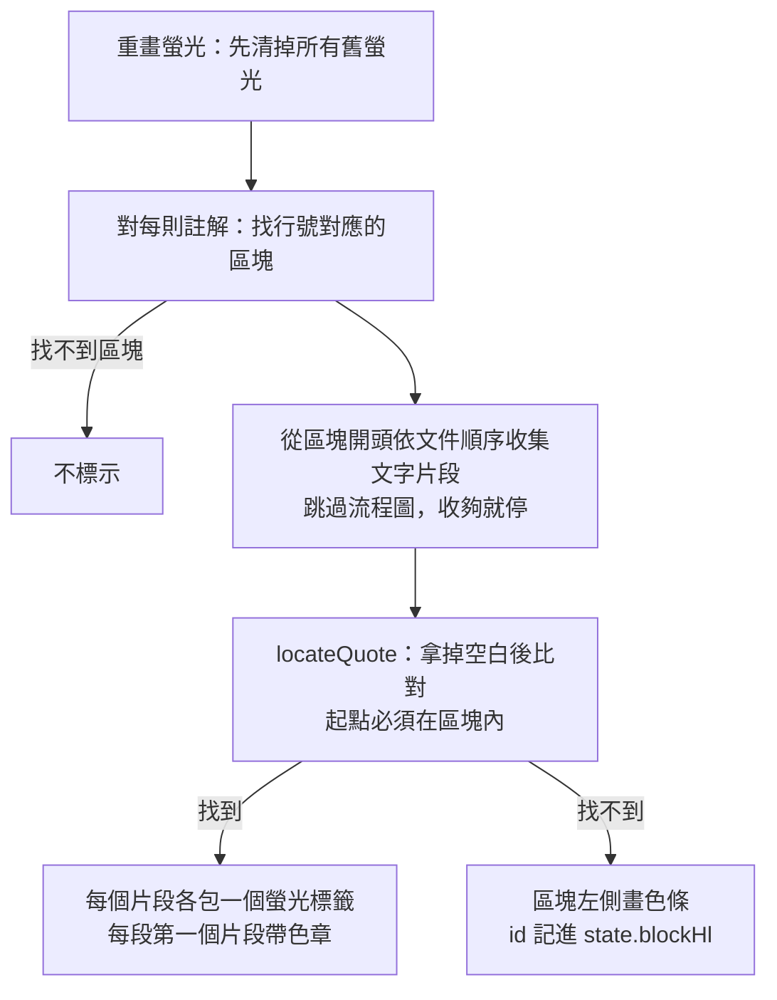

## Context

動機與使用者原話見 proposal.md。這裡整理現在的程式怎麼運作。內容都是從 0.7.0 的程式碼讀到的，也用「不開視窗、用程式操作的瀏覽器」實測過。

**行號怎麼來。** 文章渲染成網頁時，每個區塊（段落、標題、清單項目、表格、程式碼塊、流程圖）都標上它在 `.md` 裡的起始行號（`data-line` 屬性）。放開滑鼠後，程式從「選取的起點」往上找最近一個帶行號的區塊，把它的行號當成註解的行號（`reviewer.js` 的 `selInfo`）。問題在「起點」：程式用的是瀏覽器的 `anchorNode`，也就是滑鼠按下的位置。從下往上拖曳時，它在最後一段。實測選第三到第五段：從上往下拖記成第三段，從下往上拖記成第五段。另外，從一行右邊的空白處、兩段之間的空隙或分隔線開始拖，起點會落在上一段的結尾或分隔線上，記成一個根本沒有字被選到的區塊。

**螢光怎麼上。** 每則註解都在它行號那一段裡找引文，找到就用一個螢光標籤（HTML 的 `<mark>`）把引文包起來，找不到就在那段左側畫色條（`reviewer.js` 的 `applyHighlights`、`wrapQuote`）。瀏覽器會把一段文字依格式切成好幾個小片段（文字節點），程式卻只在「單一個片段」裡找。實測：連點三下選取一段含粗體、行內程式碼、連結的段落，引文是「第二段有粗體和 code 還有連結。」，但段落被切成五個片段，所以找不到，退回色條。跨段的引文更不可能落在單一片段裡。被畫色條的註解，id 會記在頁面狀態 `state.blockHl`，右側卡片用它決定要不要顯示「只刪除引文」的說明。

**分類色章。** 每個螢光標籤帶一個 `data-sym` 屬性（分類符號），CSS 用 `::before` 在螢光開頭畫一個圓形小色章（`annotation-kinds` 規格）。已解決的螢光是淡化加刪除線。

**註解檔怎麼存。** 前端每次存檔只把「註解清單」送到伺服器的存檔介面（`POST /api/save`）。伺服器把磁碟上的舊內容和這次要改的欄位合併後寫回，所以它不認得的頂層欄位會原樣保留（`server.cjs` 的 `writeSidecar`，`sidecar-integrity` 規格）。開檔介面（`GET /api/file`）只回傳註解、完成紀錄、最後更新時間等固定欄位。另外，伺服器程式只在啟動時載入一次，網頁檔案卻是每次請求都從磁碟讀；所以升級套件後如果沒重啟伺服器，就會變成「新網頁配舊伺服器」。

**限制。** 不用第三方套件，也不用編譯打包。英文與繁中兩份語系檔的字串鍵必須完全一致（`ui-i18n` 規格）。舊的註解檔不需轉換就要能開。`reviewer-diff.js` 是瀏覽器、伺服器、Node 測試三方共用的純函式模組，不碰畫面。

## Goals / Non-Goals

**Goals:**

- 引文跨過行內格式或跨段時，文章裡照文字塗螢光，不再退回左側色條。
- 不管從哪個方向、從哪裡開始拖曳，同一段選取記下的行號與引文都相同，而且行號一定是真的有字被選到的段落。
- 文章最下方有一個寫整份文件意見的文字框，內容自動存進註解檔，出現在「複製給 Claude」。
- 註解檔維持向下相容；新網頁配舊伺服器時不會讓使用者以為存好了。

**Non-Goals:**

- 不改註解的資料格式，例如不加「結束行號」欄位。跨段註解的 `context`（加註當下的段落原文快照）仍只記第一段。
- 不改重新對位的演算法（`reviewer-diff.js` 的 `reanchor`，開檔時把舊註解對回新版文件）。
- 其它意見不做「已解決」狀態、不做多則、不做 Markdown 預覽。
- 不做「滑鼠移到一片螢光時，同一則的其它片段一起亮」，也不做「跳到時閃所有片段」。

## Decisions

### 1. 行號取選取範圍裡第一個真的選到字的段落

`selInfo` 改成：在選取範圍裡，依文件順序找第一個「被選到的部分含有非空白字元」的文字片段，從它往上找最近的帶行號區塊。被選到的部分是指：起點那個片段從起點位置算起，終點那個片段算到終點位置，中間的片段整個算。

- 這個片段一定就是引文第一個字所在的地方，所以行號和決策 2 的比對起點保證指向同一段。
- 從空白處、段落空隙、分隔線開始拖曳時，前面那些沒選到字的片段會被跳過。審查時用無頭瀏覽器實測，原本出錯的四種拖法用這個做法都正確。
- 替代做法一：取瀏覽器 Range 物件的開頭（`startContainer`）。方向問題解決了，但從空白處開始拖時仍會落在上一段，不採用。
- 替代做法二：比較 `anchorNode` 與 `focusNode` 的前後關係。問題同上，不採用。
- 在流程圖裡拖曳選取時，選到的是圖裡的文字，往上找到的仍是流程圖區塊，行為不變。

### 2. 比對放進共用模組，跨片段、忽略空白

在 `reviewer-diff.js` 新增純函式 `locateQuote(texts, quote, first)`：

- `texts`：從被加註區塊的第一個文字片段開始，依文件順序排下去的文字片段內容（字串陣列）。
- `first`：前幾個片段屬於被加註的區塊。比對結果的起點必須落在這幾個片段裡，避免對到後面別段的同樣文字。
- 比對時把引文和片段內容的所有空白都拿掉再找，取第一個出現的位置。
- 回傳 `[[片段序號, 起點, 終點], …]`（終點不含），代表每個片段裡要塗色的原始字元範圍：第一個片段從起點到片段結尾，中間的片段整個（包括只有空白的片段，例如粗體和程式碼之間的那一格空白，這樣同一行裡不會出現沒塗到的小縫），最後一個片段從開頭到終點。範圍長度為零的不回傳。找不到回 `null`。

為什麼拿掉全部空白，而不是把空白壓成一格：段落、清單項目、表格格子之間，網頁裡沒有空白片段，但瀏覽器把選取轉成文字時，會在中間補換行（壓完變一格空白）。全部拿掉，兩邊就一致，不必替每種區塊邊界補虛擬空白。審查時確認過：瀏覽器的選取文字不含清單編號，也不含 `::before` 畫的色章，所以這個前提成立。

為什麼放進共用模組：這段有分支、有迴圈，放在不碰畫面的模組裡，就能在 `test/diff.test.cjs` 用 Node 直接測。

`reviewer.js` 收集片段時：

- 從被加註區塊開始，依文件順序往後收。整個跳過流程圖區塊（`.mermaid`）裡的所有片段，包括原始碼、渲染後的圖、放大按鈕。
- 離開被加註區塊之後，收到的片段「拿掉空白後的字數」累計達到「引文拿掉空白後的字數」就停，不必掃到文件結尾。兩邊都用拿掉空白後的字數，單位才一致。

替代做法：

- 用 CSS 自訂螢光（`CSS.highlights`）：不動網頁結構就能塗色，但沒有元素可以掛滑鼠提示、點擊跳卡片、`::before` 色章，不採用。
- 對整個跨片段的範圍呼叫 `surroundContents`：範圍只要切過元素邊界就會出錯，這正是現在失敗的原因，不採用。
- 先用「空白壓成一格」完全比對，失敗再拿掉全部空白：誤對的風險更低，但程式多一層，等真的遇到誤對再加。

### 3. 每個片段各包一個螢光標籤，色章每段一個

比對成功後，每個 `[片段, 起點, 終點]` 各包一個 `<mark>`。每個 `<mark>` 都帶相同的 class（`anno k-<分類>`，已解決時加 `resolved`）、`data-id` 和滑鼠提示。

- **色章**：每個帶行號的區塊裡，第一個片段帶 `data-sym`；同一段裡因為粗體、程式碼被切開的其它片段不帶。CSS 的色章選擇器改成 `mark.anno[data-sym]::before`，不帶符號的片段不會畫出空圓圈。色章每段一個，是為了遵守「不靠顏色也認得出分類」：只有第一段有的話，捲過第一段之後，後面幾段只剩顏色可以辨認。
- **點擊**：螢光的點擊處理停止事件往外傳（`stopPropagation`）。現在整段螢光一定會成功，之後再對其中一句加註，就會出現「螢光包在螢光裡」；不停止的話，點裡層會先跳到裡層卡片、又被外層搶去跳到外層卡片。
- **已解決樣式**：只淡化（`opacity`），拿掉刪除線（使用者定案）。刪除線會傳給巢狀在裡面的未解決螢光，而且子元素取消不了，裡面那則看起來就像也已解決。
- **左側色條**：只在比對失敗時畫，記錄方式（`state.blockHl`）不變。流程圖區塊因為被整個跳過，一律畫色條，結果固定，不會因為何時重畫而時有時無。
- 段落之間沒有文字片段，不會被塗色，段落的排版（邊距、清單符號、表格框線）都不變。
- 清除螢光的程式（`clearHighlights`）本來就會拆掉所有螢光標籤並合併相鄰片段；審查時確認巢狀與多片段都能正確還原，不需要改。



### 4. 其它意見放在文章下方，不放進文章容器

`reviewer.html` 在閱讀區 `#doc` 裡、文章容器 `#docInner` 後面加一個區塊 `#general`。頁面順序固定為：文章容器 → 其它意見 → 選取工具列 → 回到頂端按鈕。

- **不放進文章容器**：每次渲染文件都會整個換掉文章容器的內容；選取工具列也只認文章容器裡帶行號的區塊。
- **外觀**：寬度與文章欄相同（最大 820px 置中）。上方一條分隔線，標題用介面的小字灰色樣式，不用文章的 h2/h3 樣式，免得看起來像文件自己的最後一節。標題設成不可選取，使用者拖選文章最後一段時，不會把「其它意見」幾個字也掃進引文。文字框至少五行高、可往下拉長（`resize: vertical`），淺色與深色模式都沿用加註框輸入框的配色。
- **無障礙**：標題用 `<label for>` 綁定文字框，螢幕閱讀器會念出「其它意見」。
- **說明文字**：文字框的提示文字寫出用途與存法，例如「寫整份文件的意見，不必選取文字；會自動儲存」。
- **顯示時機**：開檔成功才顯示；沒有開文件、開檔失敗或伺服器連不上時隱藏。開檔失敗時，頁面狀態仍指向上一份文件，如果不隱藏，打的字會存進上一份文件。
- **選取工具列**：在文字框或標題上放開滑鼠時不出現工具列（放開滑鼠的排除清單加上 `#general`）。
- **Esc 與 Ctrl+Enter**：在文字框裡沒有特別作用，不會清空內容，也不需要存檔快捷鍵（自動存檔已涵蓋）。
- 替代做法：放在右側註解面板最下方。面板窄、可以收合，長段落不好寫，不採用（使用者定案放文章下方）。代價是讀到一半想寫整體意見時，要捲到最底，寫完再自己捲回原處。

### 5. 存在註解檔最上層的 `generalComment`

```json
{
  "file": "doc.md",
  "schema": 1,
  "updatedAt": "2026-10-14T08:00:00.000Z",
  "annotations": [],
  "generalComment": "整體結構太鬆，結論請放最前面。"
}
```

（伺服器合併寫入時，新欄位會接在舊欄位後面，所以實際順序可能跟範例不同。）

- **型別**：永遠是字串。日後要擴充（例如加狀態、多則），一律用新的頂層欄位，不改這個欄位的型別，免得 0.8.0 把新格式當成「不是字串」而刪掉。
- **前端狀態**：`state.generalComment`（字串）與 `state.generalEdited`（這次開檔後是否改過）。開檔時從開檔介面取回，換檔時整個換掉。
- **存檔**：文字框每次輸入就更新狀態，呼叫既有的 `markDirty`（停手 0.5 秒後存）。存檔時，只有 `state.generalEdited` 為真才在請求裡帶 `generalComment`，值直接取 `state.generalComment`，空白時送空字串。不經過匯出用的 `buildSidecar`，因為那裡空白時會省略欄位，伺服器會以為「沒帶」而不刪。
- **伺服器存檔介面**：請求裡**有** `generalComment` 這個鍵時才管它。非空白字串就照原樣寫入（不修剪，保留換行），空白或不是字串就移除這個欄位。請求裡沒有這個鍵（例如舊版網頁）就不動它。
- **伺服器開檔介面**：一律回傳 `generalComment`，不是字串時回 `""`。
- **舊伺服器偵測**：開檔回應裡沒有 `generalComment` 這個鍵，就表示伺服器是舊版。這時文字框停用，提示文字改成「伺服器版本較舊，請重新啟動 md-reviewer 後再寫其它意見」。
- **暫停存檔時唯讀**：註解檔讀不懂或與別處衝突時（`state.blocked`），文字框改成唯讀；重新載入恢復正常後解除。這時提示列已經在說明原因。
- **匯出**：`buildSidecar` 在內容非空白時帶上這個欄位。

替代做法：當成一則特殊註解（例如 `line: 0`）放進註解清單。它會出現在卡片列表、計入未解決數、跑重新對位，舊版程式和 Claude 讀回流程都要特別處理，不採用。

### 6. 複製給 Claude

「📋 複製給 Claude」的文字順序改成：標題、摘要行、**其它意見**、分類說明、編號項目、同意、已解決。

```text
# 審閱回饋：design.md
共 3 則（未解決 2），另有其它意見

其它意見：
整體結構太鬆，結論請放最前面。

分類說明（每則若另有意見，以意見補充的條件為準）：
…
```

- 其它意見有內容時，摘要行用另一個字串，結尾加「，另有其它意見」/「, plus other comments」；「其它意見：」一段原樣放內容（去頭尾空白），後面空一行。空白時兩者都不出現，輸出跟現在完全一樣。
- 放在編號項目之前：整體意見先講，也避免接在「（已解決）」後面被略讀。
- 現在「沒有任何註解」就跳提示、不複製；改成「沒有註解而且其它意見也空白」才提示。提示字改成「還沒有任何註解或其它意見」，複製按鈕的滑鼠提示改成「把未解決的註解和其它意見複製成純文字…」。

### 7. 不算待辦，但會清除審閱完成紀錄

- 其它意見沒有狀態，不算進左側清單的未解決數，也不算進「標記審閱完成」前的確認數量。
- 在已標記完成的文件上，其它意見**從空白變成有內容**的那一刻，清除完成紀錄，並在提示列說「已寫入其它意見，原本的『審閱完成』紀錄已取消」（使用者定案）。比照新增待辦註解，因為整體意見同樣是要 Claude 處理的新回饋。修改已有內容（例如修錯字）不會觸發；清空再重寫會再觸發一次。

### 8. 存檔狀態的小修正

現在存檔成功後一律把「有未存變更」清掉，就算存檔途中又打了字也一樣。這時立刻換檔，換檔前的補存會被跳過，最後幾個字就沒了。改成：每次標記變更時遞增一個計數，存檔前記下計數，回應回來時計數沒變才清掉。

### 9. 讀回說明

Claude 讀回註解檔的指引有三處，都要補上同一段意思：

- 全域 `md-reviewer` skill（claude-config repo）。
- `md-reviewer --hook` 印出的建議文字（`bin/md-reviewer.js`）。
- README 給 CLAUDE.md 用的範例（中英文兩份）。

要點：註解檔最上層可能有 `generalComment`，是整份文件的意見，不綁任何一行，照「見說明」處理；即使沒有未解決的註解、或文件已標記完成，也要讀。它沒有狀態，可能是上一輪留下的，動手前先確認文件是否已經符合，已符合就回報，不要做兩次。不要自行修改或清空它。在貼上的「📋 複製給 Claude」文字裡，它是「其它意見：」那一段。

## Risks / Trade-offs

- [拿掉全部空白後比對，可能對到錯的位置] → 例如引文是英文「into」，同一段前面有「in to」，就會先對到前面那個；中文幾乎不受影響。起點必須在被加註的區塊裡，誤對時也只是畫面標示偏移，註解檔的 `line`、`quote` 不受影響。
- [跨段註解在下一版可能又變回色條] → `context` 只記第一段。Claude 改寫了第二段以後，整個引文就對不到，螢光會退回第一段的左側色條；卡片的「原文狀態」只看第一段，可能仍顯示原文未變。README 要說明「左側色條＝原引文已經找不到」。
- [卡片上的「引文還在」提示只看第一段] → 重新對位判斷「引文還在」時，只看第一段自己的文字，所以跨段引文永遠不會出現這個提示，跟螢光有沒有塗上是兩件事。照 Non-Goal 不改。
- 新網頁配舊伺服器時，舊伺服器會把其它意見丟掉，卻照樣回報存檔成功。處置：用決策 5 的「舊伺服器偵測」停用文字框；CHANGELOG 第一次寫明「升級後要重新啟動伺服器」。
- [處理過的其它意見會一直留著] → 下一輪 Claude 可能重做一次。用讀回說明（決策 9）要求先確認是否已符合；README 告訴使用者處理完可以自己清空。
- [從選取工具列按 Shift+Tab 會進到文字框] → 瀏覽器會把閱讀區捲到最底。頁面順序已固定為「其它意見在工具列之前」，按 Tab 離開工具列時不會進到文字框；Shift+Tab 的情況可以接受。
- [一則註解變成多個螢光標籤] → 只多出跨過的片段數，對效能的影響可忽略。

## Migration Plan

- 註解檔格式只多一個選用欄位，不需要轉換。舊註解檔照常開啟；舊的跨格式、跨段註解重新開檔後，會自動改成文字螢光。
- 回退到 0.7.0：看不到其它意見，但存檔會保留 `generalComment`。0.5.x 以下的存檔會覆寫整個檔案，這個欄位會遺失。
- 發版照 RELEASING.md：版本升到 0.8.0、推 tag，由 GitHub Actions 發佈到 npm。發佈與合併 PR 都要先經使用者同意。claude-config 的 skill 更新另開 PR。

---
🤖 claude-opus-5-5[1m] · effort: xhigh · 2026-10-14
