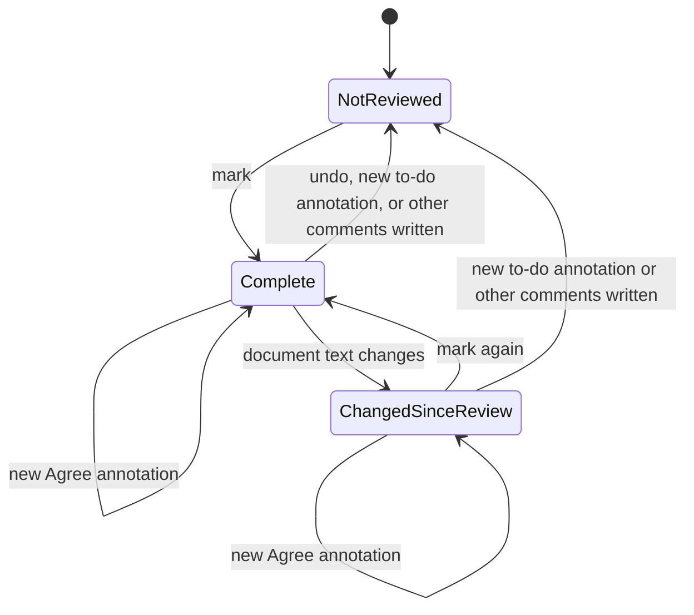

## MODIFIED Requirements

### Requirement: Review-complete record stored in the sidecar
The system SHALL store a document's review-complete record only in that document's
sidecar (`<base>.review.json`), as a top-level `review` object
`{ "status": "done", "at": <ISO time>, "hash": <64-char hex fingerprint> }`. The
field SHALL be absent when the document is not marked complete. No copy of the
record SHALL be kept in `~/.md-reviewer/`, so the record moves with the document
wherever the sidecar is synced or committed. Only a new to-do annotation (any kind
except "Agree", as defined by `annotation-kinds`) or "Other comments" text going from
blank to not blank (as defined by `general-comment`) changes a complete or changed
document back to not reviewed; a new "Agree" annotation and edits to "Other comments"
text that was already not blank leave the state as it is.

#### Scenario: Marking writes the record
- **WHEN** the user marks the open document review complete
- **THEN** its sidecar contains `review.status` `"done"`, the current time in `review.at`, and the fingerprint of the version on screen in `review.hash`

#### Scenario: Record travels with the document
- **WHEN** a document and its sidecar are copied to another machine (for example through git) and opened there
- **THEN** the document shows as review complete on that machine without any other configuration

#### Scenario: Agree on a changed document
- **WHEN** a document shows as changed since review and the user adds an "Agree" annotation
- **THEN** it still shows as changed since review and its `review` field is unchanged

### Requirement: Record follows the review workflow
Adding a new to-do annotation to a document that is marked complete SHALL remove the
record and SHALL tell the user once. A to-do annotation is any kind except "Agree"
(as defined by `annotation-kinds`); adding an "Agree" annotation SHALL keep the record
and SHALL NOT show that notice. When the "Other comments" text of a document that has
a record goes from blank to not blank, the page SHALL likewise remove the record and
tell the user once, with 「已寫入其它意見，原本的「審閱完成」紀錄已取消。」 / "Other
comments written, so the review-complete record was removed."; editing text that is
already not blank SHALL keep the record. Other comments SHALL NOT count as to-do
annotations anywhere else. Successfully marking a document complete SHALL remove it
from the "To review" list.

#### Scenario: New comment reopens the review
- **WHEN** the user adds an annotation of a kind other than "Agree" to a complete document
- **THEN** the `review` field is removed from its sidecar and the page notes that the completion was cleared

#### Scenario: Agree keeps the review complete
- **WHEN** the user adds an "Agree" annotation to a complete document
- **THEN** the `review` field is still in its sidecar and no notice about clearing the completion is shown

#### Scenario: Other comments reopen the review
- **WHEN** the user types into the empty "Other comments" box of a complete document
- **THEN** the `review` field is removed from its sidecar and the page notes once that the completion was cleared because other comments were written

#### Scenario: Editing existing other comments keeps the record
- **WHEN** a document is marked complete while its "Other comments" box already has text, and the user then fixes a typo in that text
- **THEN** the `review` field is still in its sidecar and no notice is shown

#### Scenario: Completed document leaves the queue
- **WHEN** a document in "To review" is marked complete
- **THEN** it no longer appears in "To review" and still appears in the other lists it belongs to
