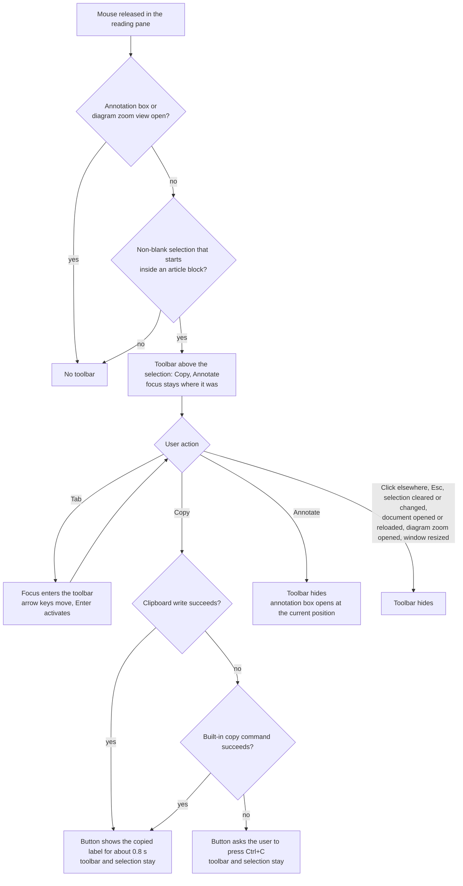

## MODIFIED Requirements

### Requirement: Selection toolbar for article text
When the user releases the mouse button in the reading pane, the page SHALL show a selection toolbar instead of opening the annotation box, provided the selection is not blank and starts inside a rendered article block.
"Not blank" means the selected text is non-empty after collapsing whitespace and
trimming. The selection's start is the first text node, in document order, whose
selected part contains a non-whitespace character; the selected part is the text
from the range's start offset in the start node, up to the range's end offset in the
end node, and the whole text of every node in between. "Inside a rendered article
block" means that walking up from that text node reaches an element carrying
`data-line` inside `#docInner`; the nearest such element is the selection's block. A
selection that begins in empty space (after the end of a line, in the gap between
blocks, or on a horizontal rule) therefore belongs to the first block whose text is
actually selected, and dragging over the same text downwards or upwards gives the same
block. The welcome screen and the left and right panels never qualify. The check SHALL run
after the browser has settled the selection, so double-click (one word) and
triple-click (one paragraph) selections also show the toolbar. A drag selection
inside a rendered diagram (`.mermaid`) SHALL also show the toolbar, so diagrams can
still be annotated.

The toolbar SHALL contain exactly two buttons, "Copy" / 「複製」 and "Annotate" /
「加註」. It SHALL NOT appear while the annotation box is open, while the diagram
zoom view is open, or when the mouse is released on the toolbar itself, the
annotation box, the back-to-top button, a diagram's zoom button or the "Other
comments" box (see `general-comment`).

When the toolbar appears it SHALL record three values from that moment: the block's
line number, the quote (whitespace collapsed to single spaces and trimmed, as used for
annotations), and the raw selection text (`Selection.toString()`, keeping line breaks
between paragraphs, as used for copying).

The toolbar SHALL be an element inside `#doc`, after `#docInner` and before the
back-to-top button, so re-rendering the document does not remove it. It SHALL be
absolutely positioned in the scrolled content of `#doc` (`#doc` is
`position: relative`) so it moves with the text when the document scrolls.
Horizontally it SHALL be aligned with the point where the mouse was released and
kept inside the reading pane; vertically it SHALL sit above the selected line at that
point, or below it when there is not enough room above. The toolbar SHALL be
`user-select: none` and its buttons SHALL prevent the browser's default action on
`mousedown`, so pressing them does not change or clear the selection. While hidden it
SHALL carry the `hidden` attribute, so its buttons cannot be reached with Tab and are
not exposed to screen readers.

The welcome text shown when no document is open (`doc.empty`) SHALL describe the new
flow: select text, then press "Copy" or "Annotate".

#### Scenario: Selecting a phrase shows the toolbar
- **WHEN** the user drags across a phrase in a paragraph and releases the mouse
- **THEN** the selection toolbar with "Copy" and "Annotate" appears above the selection
- **AND** the annotation box does not open and keyboard focus has not moved

#### Scenario: Same block in both directions
- **WHEN** the user selects the third to fifth paragraphs once by dragging downwards and once by dragging upwards
- **THEN** both times the toolbar records the third paragraph's line and the same quote

#### Scenario: Drag starting in empty space
- **WHEN** the user starts dragging to the right of the last line of a paragraph and releases the mouse inside the next paragraph
- **THEN** the toolbar records the next paragraph's line, because no text of the first paragraph is selected

#### Scenario: Drag starting on a horizontal rule
- **WHEN** the user starts dragging on a horizontal rule and releases the mouse inside the paragraph after it
- **THEN** the toolbar records that paragraph's line

#### Scenario: Toolbar moves with the text
- **WHEN** the toolbar is shown and the user scrolls the document a little
- **THEN** the toolbar stays next to the selected text and remains visible

#### Scenario: Not enough room above
- **WHEN** the user selects text on the first visible line at the top of the reading pane
- **THEN** the toolbar appears below that line, inside the reading pane

#### Scenario: Selection outside the article
- **WHEN** the user selects text in the welcome screen, the left list or the annotations panel
- **THEN** no selection toolbar appears

#### Scenario: Double-click on a diagram opens the zoom view only
- **WHEN** the user double-clicks a rendered diagram, which both selects a word and opens the diagram zoom view
- **THEN** the zoom view opens and no selection toolbar appears

#### Scenario: Drag selection inside a diagram
- **WHEN** the user drags across text inside a rendered diagram and releases the mouse
- **THEN** the selection toolbar appears, and "Annotate" records the diagram's line number

#### Scenario: Pressing a toolbar button keeps the selection
- **WHEN** the user presses the mouse button on "Copy" or "Annotate"
- **THEN** the selected text in the article is still selected

#### Scenario: Hidden toolbar is not reachable
- **WHEN** no toolbar is shown and the user tabs through the page
- **THEN** focus never lands on the toolbar's buttons

#### Scenario: Welcome text describes the new flow
- **WHEN** no document is open, in either English or Traditional Chinese
- **THEN** the welcome text says to select text and then press "Copy" or "Annotate"

---
🤖 claude-opus-5-5[1m] · effort: xhigh · 2026-10-14
