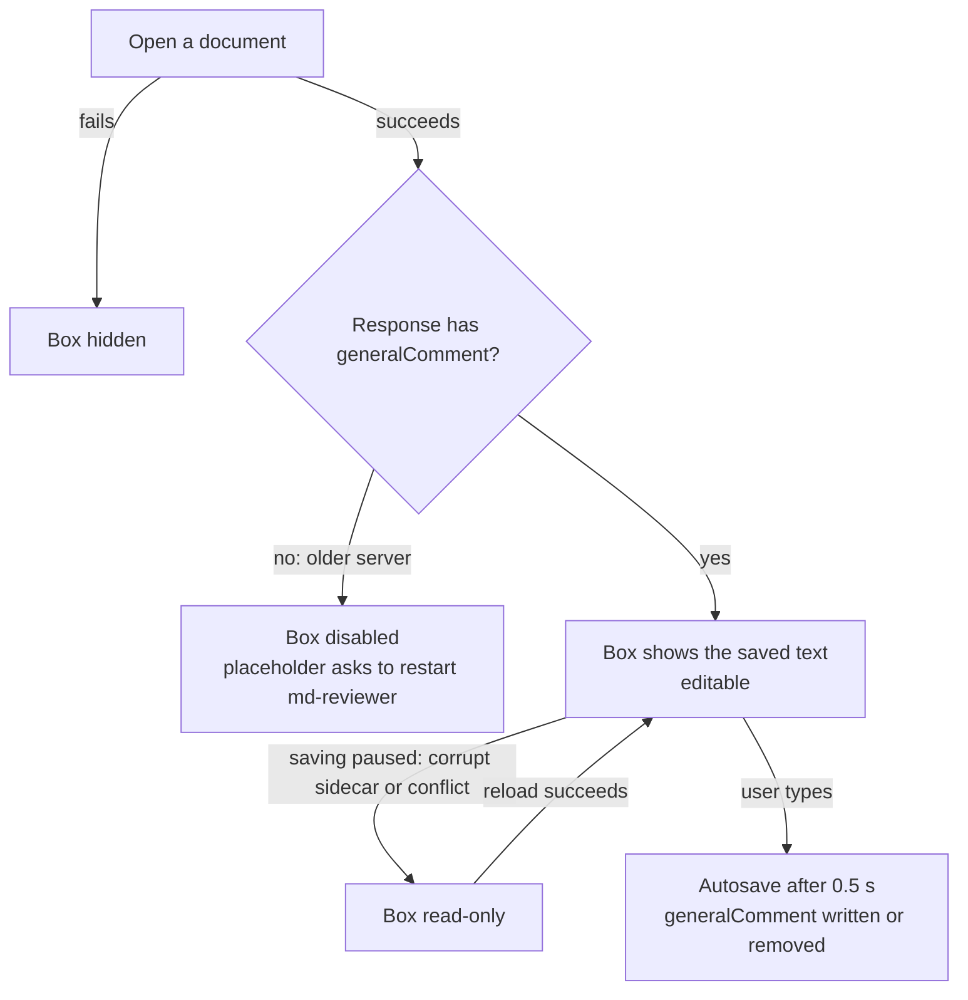

# general-comment Specification

## Purpose
Let the reviewer write comments about the whole document, not tied to any passage, in a box below the article; save them in the sidecar next to the document and hand them to the author together with the annotations.
## Requirements
### Requirement: Other comments box below the article
The reading pane SHALL show, after the rendered document, a labelled multi-line text box for comments on the whole document that are not tied to any passage.

- The box SHALL be an element `#general` inside `#doc`, after `#docInner` and before the
  selection toolbar and the back-to-top button, so re-rendering the document does not
  remove it.
- It SHALL have the same width as the article column. Its title, "Other comments" /
  「其它意見」, SHALL use the interface's small muted style (not the article's heading
  style), SHALL be `user-select: none`, and SHALL be a `<label>` bound to the text box.
- The text box SHALL be at least five lines tall, resizable vertically, and use the
  same colors as the annotation box's input in both light and dark mode. Its
  placeholder SHALL say what it is for and that it saves automatically, in the
  interface language.
- The box SHALL be shown only while a document is open; it SHALL be hidden when no
  document is open and when opening a document fails or the server cannot be reached.
- Releasing the mouse inside the box SHALL NOT show the selection toolbar. Esc and
  Ctrl+Enter inside the box SHALL NOT clear it.

#### Scenario: Box after the document
- **WHEN** a document is opened
- **THEN** the "Other comments" box appears below the last block of the document, and the article's last paragraph can be selected without selecting the box's title

#### Scenario: Open fails
- **WHEN** a document is open and the user then opens a path that cannot be read
- **THEN** the error is shown and the "Other comments" box is hidden

#### Scenario: Selecting inside the box
- **WHEN** the user selects text inside the box and releases the mouse
- **THEN** no selection toolbar appears

#### Scenario: Dark mode
- **WHEN** the system uses a dark color scheme
- **THEN** the text box uses the dark background and text colors of the annotation box's input

### Requirement: Other comments are saved in the sidecar
The text of the box SHALL be saved automatically in the sidecar as the top-level string field `generalComment`, through the same autosave as annotations.

- Each edit SHALL update the page's copy of the text and start the usual autosave
  (about 0.5 s after the last change).
- A save request SHALL include `generalComment` only after the box has been edited
  since the document was opened, and then always as a string (`""` when blank). It
  SHALL be sent from the page state, not from the export structure.
- `generalComment` SHALL always be a string. A later version that needs more structure
  SHALL use a new top-level field instead of changing this field's type.
- `GET /api/file` SHALL always return `generalComment`: the sidecar's value when it is
  a string, otherwise `""`.
- The exported sidecar ("⬇ Export") SHALL include `generalComment` when the text is not
  blank.
- Other comments SHALL NOT have a status, SHALL NOT be counted in the left list's
  open count, and SHALL NOT be counted by the confirmation shown before marking a
  review complete.
- A save that succeeds SHALL clear the "unsaved changes" state only when nothing was
  edited while it was in flight, so switching documents right after typing still saves
  the last characters.

#### Scenario: Typing is saved
- **WHEN** the user types in the box and waits one second
- **THEN** the sidecar contains `generalComment` with exactly the typed text, line breaks included

#### Scenario: Clearing removes the field
- **WHEN** the sidecar has `generalComment` and the user deletes all text in the box and waits one second
- **THEN** the sidecar no longer has a `generalComment` field, and reopening the document shows an empty box

#### Scenario: Reopening shows the text
- **WHEN** the user reopens a document whose sidecar has `generalComment`
- **THEN** the box shows that text

#### Scenario: Switching documents while typing
- **WHEN** the user types in the box of document A and immediately opens document B
- **THEN** A's sidecar contains the full typed text and B's box shows B's own text

#### Scenario: Not edited, not sent
- **WHEN** the user opens a document and only resolves an annotation
- **THEN** the save request has no `generalComment` key and the sidecar's `generalComment` is unchanged

#### Scenario: Export
- **WHEN** the box has text and the user presses "⬇ Export"
- **THEN** the downloaded file contains `generalComment` with that text

### Requirement: Older server is detected
When the response of `GET /api/file` has no `generalComment` key, the page SHALL treat the server as an older version that would drop the field, SHALL disable the box, and SHALL replace its placeholder with a message asking the user to restart md-reviewer before writing other comments.

#### Scenario: New page with an old server
- **WHEN** the page is served from the new files but the running server does not return `generalComment`
- **THEN** the box is disabled and its placeholder asks the user to restart md-reviewer

### Requirement: Box is read-only while saving is paused
While autosave is paused because the sidecar cannot be read or another tab or machine has updated it, the text box SHALL be read-only; it SHALL become editable again once a reload succeeds.

#### Scenario: Conflict
- **WHEN** another tab saved the same document's sidecar and this tab's save is refused as out of date
- **THEN** this tab's box becomes read-only until the user reloads the document

### Requirement: Read-back guidance includes other comments
Every place that tells an agent how to read the sidecar back SHALL say that the sidecar may have a top-level `generalComment` with comments on the whole document.
These places are the text printed by `md-reviewer --hook` and the suggested CLAUDE.md
instruction in `README.md` and `README.zh-Hant.md`. The guidance SHALL say to handle it
like a "See comment" annotation even when there are no open annotations or the
document is marked complete; that it has no status and may be left from an earlier
round, so the agent checks whether the document already satisfies it before acting;
and that the agent does not edit or clear it. The READMEs SHALL also tell the user they
can clear the box once its comments have been handled, and SHALL describe
`generalComment` in the sidecar format section.

#### Scenario: Hook text
- **WHEN** the user runs `md-reviewer --hook`
- **THEN** the printed suggestion mentions `generalComment`

#### Scenario: README sidecar format
- **WHEN** a reader looks up the sidecar format in either README
- **THEN** `generalComment` is listed as an optional string with comments on the whole document
