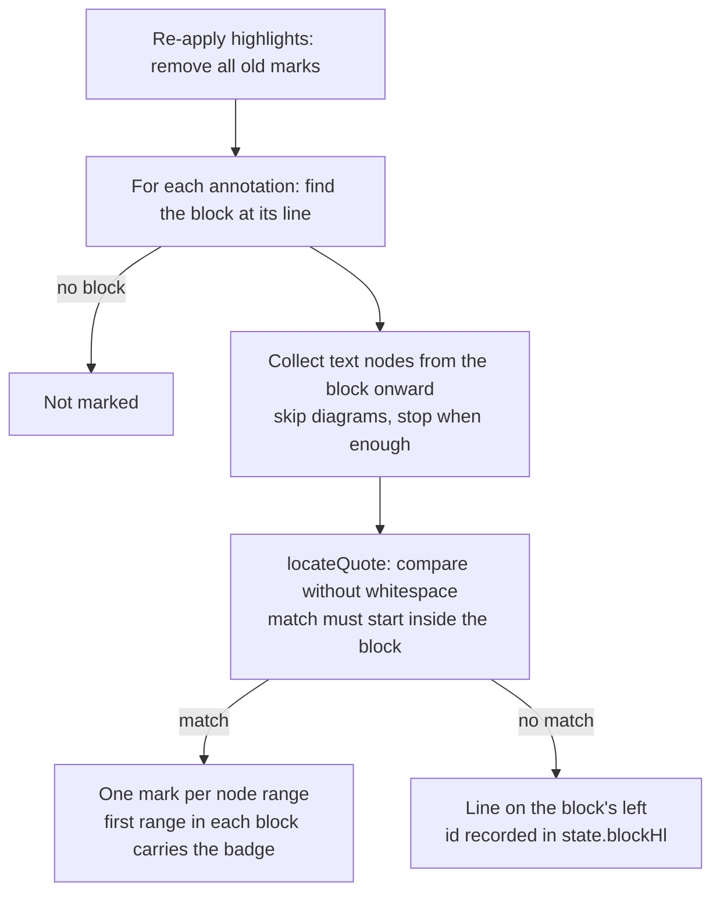

# quote-highlighting Specification

## Purpose
Show where each annotation applies by coloring the quoted text itself in the rendered document, even when the quote crosses inline formatting or several blocks, and fall back to a line on the block's left only when the quote can no longer be found.
## Requirements
### Requirement: Quote is highlighted as text across formatting and blocks
The reviewer SHALL highlight an annotation's quote by coloring the quoted text itself, even when the quote spans inline formatting (bold, italic, inline code, links) or several blocks (paragraphs, list items, table cells).

The match SHALL be found by the shared pure function
`locateQuote(texts, quote, first)` in `reviewer-diff.js`:

- `texts` is the list of text-node values in document order, starting with the first
  text node of the annotated block (the element whose `data-line` equals the
  annotation's `line`) and continuing after it.
- `first` is how many of those text nodes are inside the annotated block. A match
  SHALL start in one of these nodes; otherwise there is no match.
- Matching SHALL ignore all whitespace: the quote and the text are compared with every
  whitespace character removed, and the first occurrence is used.
- The result SHALL be a list of `[node index, from, to]` ranges (`to` exclusive) over
  the original text: from the match start to the end of the first node, every middle
  node in full (including whitespace-only nodes), and from the start of the last node
  to the match end. Empty ranges SHALL NOT be returned. When there is no match the
  result SHALL be `null`.

When collecting text nodes, the page SHALL skip every text node inside a diagram block
(`.mermaid`), including its source text, the rendered diagram and its zoom button.
After leaving the annotated block it SHALL stop collecting once the nodes collected
outside the block hold, with whitespace removed, at least as many characters as the
quote with whitespace removed.

Each range SHALL be wrapped in its own `<mark>` carrying the annotation's classes
(`anno k-<kindOf(a)>`, plus `resolved` when resolved), `data-id` and tooltip. Text
between blocks is not part of any range, so the layout of the blocks (margins, list
markers, table borders) SHALL stay unchanged.

#### Scenario: Whole paragraph with formatting
- **WHEN** the user triple-clicks a paragraph that contains bold text, inline code and a link and saves an annotation
- **THEN** the whole paragraph's text is colored and no line is drawn on its left

#### Scenario: Three paragraphs selected bottom-up
- **WHEN** the user drags from the end of the fifth paragraph up to the start of the third paragraph and saves an annotation
- **THEN** the text of the third, fourth and fifth paragraphs is colored, the gaps between them are not, and the annotation's `line` is the third paragraph's line

#### Scenario: Match must start in the annotated block
- **WHEN** `locateQuote` is called with a quote that appears only in a node after the first `first` nodes
- **THEN** it returns `null`

#### Scenario: Whitespace differences are ignored
- **WHEN** `locateQuote` is called with texts `["第三段 A。", "第四段 B。"]`, quote `"第三段 A。 第四段 B。"` and `first` 1
- **THEN** it returns `[[0, 0, 6], [1, 0, 6]]`

#### Scenario: Whitespace-only middle node is colored
- **WHEN** `locateQuote` is called with texts `["有", "粗體", " ", "code"]`, quote `"有粗體 code"` and `first` 4
- **THEN** the result includes `[2, 0, 1]`, so there is no uncolored gap between the bold text and the code

### Requirement: Kind badge in every block of a highlight
Within one annotation's highlight, the first `<mark>` inside each block (each nearest element carrying `data-line`) SHALL carry `data-sym`, and the other marks SHALL NOT.
Marks without `data-sym` SHALL NOT draw the badge: the badge selector SHALL be
`mark.anno[data-sym]::before`. So a highlight spanning three paragraphs shows three
badges, one at the start of each paragraph's colored text, and a paragraph split by
bold text or code still shows one badge.

#### Scenario: Badge after scrolling
- **WHEN** a highlight spans three paragraphs and the user scrolls so only the third paragraph is visible
- **THEN** the third paragraph's colored text starts with the kind's badge

#### Scenario: One badge per paragraph
- **WHEN** a highlight covers one paragraph that contains bold text and a link
- **THEN** exactly one badge is shown in that paragraph

### Requirement: Whole-block mark only when the quote is not found
The reviewer SHALL mark the annotated block with a line on its left only when `locateQuote` finds no match, and SHALL then record the annotation's id in `state.blockHl` as before.
Because diagram blocks are skipped, an annotation on a diagram SHALL always be shown
as a line on the diagram's left, no matter when the highlights were last re-applied.

#### Scenario: Quote removed from the document
- **WHEN** the quoted text was deleted from the document and the document is reopened
- **THEN** the annotated block is marked with a line on its left

#### Scenario: Annotation on a diagram
- **WHEN** a document with an annotation on a rendered diagram is opened, and the user then resolves another annotation
- **THEN** the diagram is marked with a line on its left both before and after resolving

### Requirement: Clicking a highlight focuses its own card
Clicking a highlight SHALL scroll to and flash the card of the annotation that highlight belongs to, and SHALL stop the click from reaching enclosing highlights.

#### Scenario: Nested highlights
- **WHEN** a sentence annotated on its own lies inside a paragraph annotated as a whole, and the user clicks the sentence
- **THEN** the sentence's card is the one scrolled to and flashed
